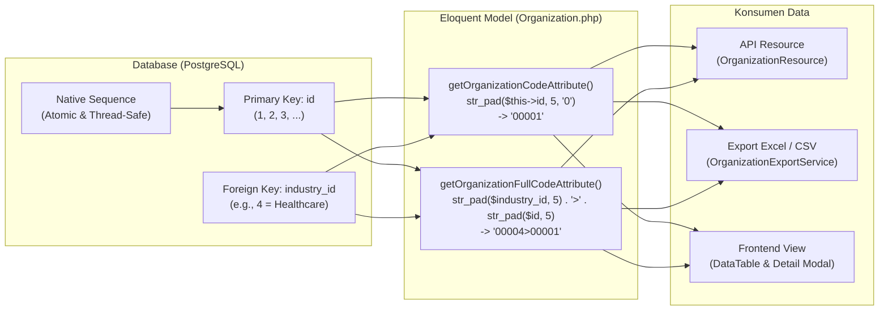

# Arsitektur Kode Organisasi: Transisi dari Kolom Sequence Fisik ke Dynamic Accessor

Dokumen ini menjelaskan secara komprehensif latar belakang teknis, analisis masalah pada pendekatan lama (_legacy_), dan alasan arsitektural mengapa sistem beralih dari kolom fisik `organization_code` ke strategi **Dynamic Accessor berbasis auto-increment `id`**.

---

## 1. Latar Belakang & Pola Pendekatan Lama (Legacy)

Pada sistem lama (`CompanyController` dan tabel `company`), setiap perusahaan diberikan kode numerik unik yang dihitung **per jenis perusahaan** (`company_type_id`).

### Format Kode Lama
Kode lengkap ditampilkan dalam format gabungan:
$$\text{company\_type\_code} > \text{company\_code}$$
Contoh:
- `00001>00001` : Perusahaan Rumah Sakit ke-1
- `00001>00002` : Perusahaan Rumah Sakit ke-2
- `00002>00001` : Perusahaan Manufaktur ke-1

### Implementasi Generator Lama
Untuk menentukan nomor berikutnya, controller memanggil fungsi manual:
```php
private function nextCompanyCode(int|string $companyTypeId, ?int $ignoreCompanyId = null): int
{
    $query = Company::query()
        ->where('company_type_id', $companyTypeId)
        ->when($ignoreCompanyId !== null, fn($b) => $b->where('company_id', '!=', $ignoreCompanyId));

    $nextCode = $query->lockForUpdate()->pluck('company_code')
        ->map(fn($code) => (int) $code)
        ->max() + 1;

    return $nextCode;
}
```

---

## 2. Analisis Akar Masalah Teknis

Pendekatan sequence per kelompok yang dihitung manual di level aplikasi memiliki kelemahan arsitektural fatal:

### A. Ketiadaan Fitur Native RDBMS untuk Group-Partitioned Auto-Increment
Mesin database relasional standar (PostgreSQL, MySQL) hanya menyediakan **satu native sequence / auto-increment atomik per tabel** (biasanya dialokasikan untuk Primary Key `id`). Database **tidak** memiliki fitur bawaan untuk me-reset penomoran otomatis berdasarkan nilai kolom lain (`industry_id`). Akibatnya, kalkulasi terpaksa ditarik ke lapisan aplikasi (PHP).

### B. Race Condition (Benturan Nomor Kembar)
Adanya jeda waktu antara operasi **Read** (`SELECT MAX`) dan operasi **Write** (`INSERT`) menciptakan celah waktu di mana proses konkruen membaca angka yang sama:

```
Timeline      Koneksi A (User Simpan RS)              Koneksi B (User Import Excel RS)
   │
   ├── [0.00s] SELECT MAX(code) WHERE type=1
   │           Hasil: 10
   │                                             ├── [0.01s] SELECT MAX(code) WHERE type=1
   │                                             │           Hasil: MASIH 10 (A belum commit!)
   ├── [0.02s] Hitung: 10 + 1 = 11               ├── [0.02s] Hitung: 10 + 1 = 11
   ├── [0.03s] INSERT code = 11 (SUKSES)         │
   │                                             └── [0.03s] INSERT code = 11
   │                                                         💥 CRASH! ERROR:
   │                                                         Duplicate key violates unique constraint
   ▼                                                         "industry_organization_code_unique"
```

### C. Bottleneck Kinerja Akibat Row/Table Locking
Untuk menanggulangi race condition, kode lama menyertakan `lockForUpdate()`. Namun penguncian baris ini menimbulkan konsekuensi buruk:
1. **Antrian Transaksi (Serialization Bottleneck)**: Ketika proses impor batch sedang memasukkan ratusan baris industri Rumah Sakit, semua pengguna lain yang ingin membuat organisasi Rumah Sakit akan mengalami _freeze_ menunggu lock dilepas.
2. **Risiko Deadlock**: Jika dua transaksi konkuren mengimpor data yang mencakup multi-industri dengan urutan berbeda (Koneksi 1: RS lalu IT; Koneksi 2: IT lalu RS), PostgreSQL akan mendeteksi circular lock dan membatalkan paksa salah satu transaksi (_deadlock detected_).
3. **Kegagalan Lock Tanpa Transaksi**: Pada method `import()` lama, loop eksekusi tidak dibungkus dalam `DB::beginTransaction()`. Pada level SQL, `SELECT ... FOR UPDATE` di luar blok transaksi aktif **langsung melepaskan lock seketika**, sehingga proteksi lock menjadi tidak berguna dan duplikasi tetap tembus.

### D. Fragilitas Saat Perubahan Data (Update & Delete)
- **Perubahan Industri**: Jika pengguna salah memilih industri dan mengubahnya dari "Healthcare" ke "Software", kode lamanya di "Healthcare" menjadi berlubang (ada angka lompat), sementara di "Software" harus dibuat kode baru.
- **Penghapusan Record**: Menghapus record menyebabkan nomor urut bolong (`1, 2, 4, 5`). Menutup lubang ini (_gap filling_) memerlukan query pencarian angka hilang yang sangat lambat dan kompleks.

---

## 3. Solusi Arsitektur Baru: Dynamic Accessor Berbasis `id`

Pada arsitektur baru (`organizations`), kolom fisik `organization_code` dihapus dari tabel database. Penomoran dialihkan sepenuhnya ke **Dynamic Accessor** berbasis `id` auto-increment.



### Implementasi pada Model `Organization.php`
```php
/**
 * Kode numerik organisasi yang dipad 5 digit.
 * Contoh: "00001", "00042"
 */
public function getOrganizationCodeAttribute(): string
{
    return str_pad((string) $this->id, 5, '0', STR_PAD_LEFT);
}

/**
 * Kode organisasi lengkap berformat [Kode Industri]>[Kode Organisasi].
 * Contoh: "00004>00001"
 */
public function getOrganizationFullCodeAttribute(): string
{
    $industryPart = str_pad((string) ($this->industry_id ?? 0), 5, '0', STR_PAD_LEFT);
    $orgPart = str_pad((string) $this->id, 5, '0', STR_PAD_LEFT);

    return "{$industryPart}>{$orgPart}";
}
```

---

## 4. Matriks Perbandingan

| Dimensi | Pendekatan Lama (`company_code`) | Pendekatan Baru (Dynamic Accessor) |
|---|---|---|
| **Penyimpanan Database** | Kolom fisik `INT` + `UNIQUE(industry_id, code)` | Tidak ada kolom fisik (menggunakan `id` PK) |
| **Pencegahan Race Condition** | Manual via `lockForUpdate()` (rawan bocor & deadlock) | **100% Native Atomic** dari sequence PostgreSQL |
| **Kinerja Impor Batch** | Lambat ($O(N)$ query pencarian MAX + lock per baris) | **Sangat Cepat** (single batch `INSERT` tanpa lock) |
| **Karakter Urutan Nomor** | Urut lokal per tipe industri (`RS-1`, `RS-2`) | Urut global sistem (`00004>00001`, `00004>00003`) |
| **Dampak Edit Industri** | Kode rusak atau harus di-generate ulang | **Stabil** (identitas ID organisasi tetap abadi) |
| **Dampak Hapus Record** | Menimbulkan nomor bolong pada tipe industri | Tidak memengaruhi logika aplikasi apa pun |
| **Kompatibilitas Ekspor** | `$company->company_full_code` | `$organization->organization_full_code` (identik) |

---

## 5. Dampak pada Seluruh Lapisan Sistem

1. **Migration (`create_organizations_table`)**:
   - Kolom `organization_code` dan indeks `industry_organization_code_unique` dihapus.
   - Skema menjadi lebih bersih, ramping, dan bebas dari kendala constraint yang rapuh.
2. **Import Service (`OrganizationImportService`)**:
   - Tidak ada lagi pemanggilan `nextCompanyCode()`.
   - Proses impor dapat memanfaatkan chunking murni dan transaksi cepat tanpa resiko benturan kode.
3. **Export Service (`OrganizationExportService`)**:
   - Kolom "Kode Organisasi" di Excel dan CSV tetap terisi format rapi (`00001` atau `00004>00001`) via accessor tanpa ada perubahan struktur laporan.
4. **API & Frontend**:
   - `OrganizationResource` secara transparan menyediakan atribut `organization_code` dan `organization_full_code` sehingga lapisan frontend tidak merasakan perbedaan kontraktual.

